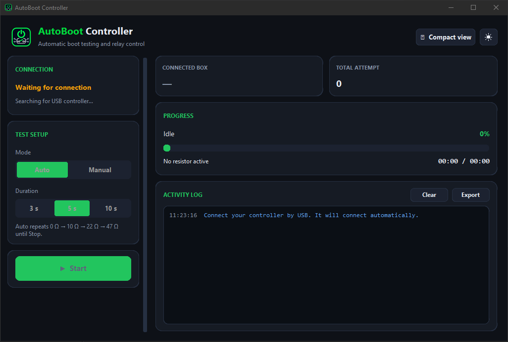

# AutoBoot Box

Automatic boot resistance switching for ISP repair workflows, controlled by the
AutoBoot Controller Windows app over USB.

## Download the Windows app

- [Windows 64-bit (x64)](https://github.com/iqbal-rashed/autoboot-box/releases/latest/download/AutoBootController-windows-x64.exe)
- [Windows 32-bit (x86)](https://github.com/iqbal-rashed/autoboot-box/releases/latest/download/AutoBootController-windows-x86.exe)
- [Latest release notes and checksums](https://github.com/iqbal-rashed/autoboot-box/releases/latest)

The download links follow the latest stable release. Choose the executable that
matches your Windows architecture. The portable app runs without a Python installation.

## Features

- **Auto mode:** repeatedly scan 0, 10, 22, and 47 Ω until you press Stop.
- **Manual mode:** repeat tests with your selected resistance.
- **Test duration:** choose 3, 5, or 10 seconds per resistance.
- **Full and compact views:** use the complete workspace or a smaller control window.
- **Live progress:** track attempts, elapsed time, and the active resistance.
- **Activity log:** review, clear, and export test activity.
- **F64 monitoring:** detect F64 and hold the active resistance after a successful UFS connection.
- **Relay pulse:** choose continuous relay activation or timed pulses with compatible firmware.
- **USB setup:** select your controller once and reconnect automatically using its saved USB identity.
- **Offline FTDI driver setup:** install the bundled driver from Full view when needed.

## Get started

1. Download and run the Windows app for your architecture.
2. Connect your AutoBoot Box by USB. If its FTDI driver is missing, use
   **Install FTDI driver** in Full view and approve the Windows administrator prompt.
3. Select the controller's COM port and click **Connect** for first-time setup.
   The app remembers a controller with a unique USB serial identity for future connections.
4. Choose **Auto** or **Manual**, select the duration, and press **Start**.
5. Press **Stop** to end testing and release the relays. Use **Compact view**
   when you want a smaller window.

You need an AutoBoot Box to switch resistances. Use it alongside your ISP tool;
the controller handles resistance switching and does not replace that tool.
Bundled FTDI driver setup supports Windows 10 version 2004 or newer and
Windows 11 on x86/x64.

See the [quick-start guide](landing/public/quickstart.txt) for more details.

## Website development

The website is in [`landing/`](landing/). See its
[development and deployment guide](landing/README.md) for setup, checks, and
Vercel configuration.

This repository contains the website and hosts public app releases. Desktop and
firmware source are maintained in a separate private project.
